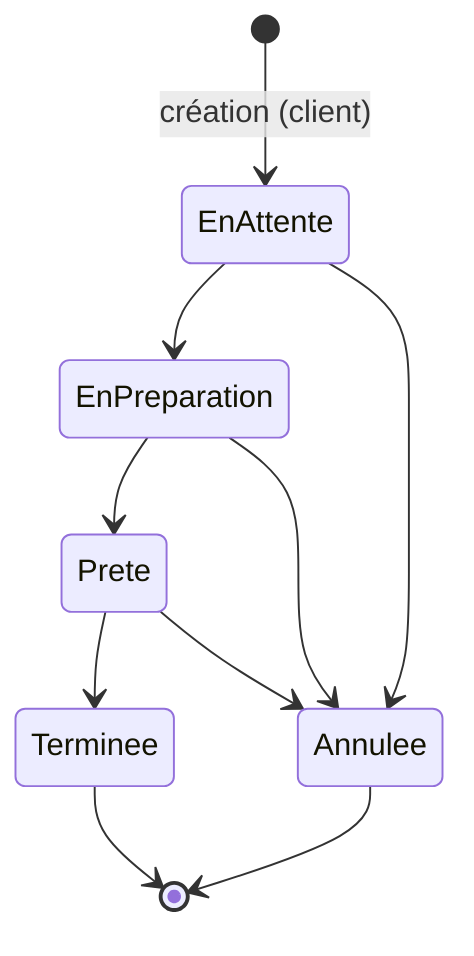

# Resto

Application de gestion de restaurant : API ASP.NET Core 8 (`backend/`), PostgreSQL, frontend à venir (`frontend/`).

## Prérequis

- SDK .NET 8
- Outil EF Core : `dotnet tool install --global dotnet-ef --version 8.*`
- Une base PostgreSQL accessible (par exemple Neon)

## Configuration

Les valeurs se stockent dans les user-secrets du projet (`UserSecretsId` déjà défini dans `Resto.Api.csproj`) ou dans des variables d'environnement. Ne jamais les committer.

| Clé | Rôle |
| --- | --- |
| `ConnectionStrings:Default` | Chaîne de connexion PostgreSQL (obligatoire, l'API refuse de démarrer sans elle) |
| `Jwt:SecretKey` | Clé de signature HS256, 32 caractères minimum (l'API refuse de démarrer sinon) |
| `Jwt:Issuer`, `Jwt:Audience` | Non secrets, dans `appsettings.json` |
| `Jwt:AccessTokenMinutes` | Durée de vie du jeton (60 par défaut) |
| `Cors:AllowedOrigins` | Tableau des origines autorisées (défaut `http://localhost:5173`) |
| `Seed:AdminPassword` | Mot de passe du compte `admin` créé par le seed (sans lui, l'admin n'est pas créé) |

```powershell
cd backend/src/Resto.Api
dotnet user-secrets set "ConnectionStrings:Default" "<chaine-de-connexion>"
dotnet user-secrets set "Seed:AdminPassword" "<mot-de-passe>"
```

## Base de données et lancement

```powershell
cd backend
dotnet ef database update -p src/Resto.Api -s src/Resto.Api
cd src/Resto.Api
dotnet run
```

- API : http://localhost:5118 (Swagger sur `/swagger`, santé sur `/health`).
- En Development, le seed (rôles, admin, paramètres, horaires, tables) s'exécute au démarrage ; les données ne sont insérées que si les tables sont vides. Il ne touche pas au catalogue (voir « Catalogue » plus bas).
- Hors Development, le seed ne tourne que sur demande : `dotnet run -- --seed` (il s'arrête ensuite).
- Aucune migration n'est appliquée automatiquement.

## Authentification

Toutes les routes exigent un jeton `Authorization: Bearer <jwt>`, sauf `register`, `login` et `/health`. Exemples dans `backend/src/Resto.Api/Resto.Api.http`.

| Méthode | Route | Accès | Rôle |
| --- | --- | --- | --- |
| POST | `/api/auth/register` | Anonyme (10 req/min/IP) | Crée un compte Client, renvoie 201 |
| POST | `/api/auth/login` | Anonyme (10 req/min/IP) | Renvoie jeton, expiration et profil ; verrouillage 10 min après 5 échecs |
| GET | `/api/auth/me` | Authentifié | Profil du jeton |
| PUT | `/api/auth/me` | Authentifié | Modifie nom, téléphone, langue |
| POST | `/api/auth/me/password` | Authentifié | Change le mot de passe (ancien + nouveau) |
| GET | `/api/admin/users` | Admin | Liste paginée (`page`, `pageSize` ≤ 50, `search`) |
| PATCH | `/api/admin/users/{id}/actif` | Admin | Active ou désactive un compte (jamais le sien) |

Un compte désactivé est refusé à chaque requête, même avec un jeton encore valide. Les erreurs suivent RFC 7807 (`application/problem+json`).

## Menu et restaurant

Routes publiques (anonymes, GET). `lang=fr|ar` (défaut `fr`, repli sur le français si la traduction est vide). Le menu est servi avec `Cache-Control: public, max-age=60` : une modification admin peut mettre jusqu'à 60 s à apparaître.

| Méthode | Route | Rôle |
| --- | --- | --- |
| GET | `/api/menu` | Catégories actives ayant au moins un article actif, avec leurs articles actifs |
| GET | `/api/menu/categories` | Catégories actives ayant au moins un article actif |
| GET | `/api/menu/articles` | Articles paginés (`categorieId`, `populaire`, `recherche`, `page`, `pageSize` ≤ 50) |
| GET | `/api/menu/articles/{id}` | Détail d'un article |
| GET | `/api/restaurant` | Paramètres, horaires des 7 jours, `ouvertMaintenant` (fuseau Africa/Tunis) |

Un article indisponible reste visible (`disponible: false`). Un article inactif, ou dont la catégorie est inactive, n'est jamais renvoyé.

Administration (rôle Admin). Il n'y a aucune route DELETE : « supprimer » = désactiver.

| Méthode | Route | Rôle |
| --- | --- | --- |
| GET, POST | `/api/admin/categories` | Liste complète (inactives incluses), création |
| GET, PUT | `/api/admin/categories/{id}` | Détail, modification |
| PATCH | `/api/admin/categories/{id}/active` | Active/désactive (409 si articles actifs) |
| PUT | `/api/admin/categories/ordre` | Réordonne : `{ "ids": [..] }` dans le nouvel ordre |
| GET, POST | `/api/admin/articles` | Liste paginée (`categorieId`, `actif`, `disponible`, `recherche`), création |
| GET, PUT | `/api/admin/articles/{id}` | Détail, modification |
| PATCH | `/api/admin/articles/{id}/disponible` | Disponible ou non |
| PATCH | `/api/admin/articles/{id}/actif` | Active/désactive |
| PUT | `/api/admin/articles/ordre` | Réordonne (articles d'une même catégorie) |
| PUT | `/api/admin/restaurant` | Paramètres (frais, minimum, téléphone, e-mail, adresse) |
| PUT | `/api/admin/restaurant/horaires` | Remplace les 7 horaires (`HH:mm`, `jourSemaine` 0 = dimanche à 6 = samedi) |
| PATCH | `/api/admin/restaurant/commandes-ouvertes` | Ouvre ou ferme la prise de commandes |

`ImageUrl` : chemin relatif `/images/<nom>` (lettres, chiffres, `.`, `_`, `-`) ou URL `https`. Une fermeture antérieure à l'ouverture signifie une fermeture après minuit.

## Panier et commandes

Toutes ces routes exigent un compte connecté. **Décision assumée : les invités anonymes ne peuvent pas commander** (la FallbackPolicy exige un jeton) ; un client sur place doit créer un compte, puis scanner le QR de sa table. L'identité vient toujours du jeton : aucun `userId` ni `panierId` n'est lu dans les requêtes.

| Méthode | Route | Rôle |
| --- | --- | --- |
| GET | `/api/panier?lang=` | Panier (créé à la volée) : lignes, prix courants, sous-total, `avertissement` par ligne (`inactif`, `indisponible`) |
| POST | `/api/panier/items` | `{articleId, quantite}` : ajoute et cumule (plafond 20) |
| PUT | `/api/panier/items/{articleId}` | `{quantite}` (1 à 20) : fixe la quantité |
| DELETE | `/api/panier/items/{articleId}` | Retire la ligne (idempotent) |
| DELETE | `/api/panier` | Vide le panier (idempotent) |
| POST | `/api/commandes` | `{typeCommande, telephone, note?, adresseLivraison?, tableCode?}` : crée la commande depuis le panier |
| GET | `/api/commandes` | Mes commandes, paginées (`page`, `pageSize` ≤ 50), plus récentes d'abord |
| GET | `/api/commandes/{id}` | Détail avec lignes et historique (404 si la commande d'un autre) |
| POST | `/api/commandes/{id}/annuler` | Annule une commande `EnAttente` (409 sinon) |
| GET | `/api/tables/{code}` | Anonyme : `{numero}` d'une table active, sinon 404 |

Les énumérations (`typeCommande`, `statut`...) s'échangent en chaînes : `SurPlace`, `ARemporter`, `Livraison` ; `EnAttente`, `EnPreparation`, `Prete`, `Terminee`, `Annulee`.

Règles métier de `POST /api/commandes` :

- Refus (409) si `CommandesOuvertes` est faux ou si le restaurant est fermé (horaires, fuseau Africa/Tunis).
- Panier vide : 400. Article devenu inactif ou indisponible : 409 avec la liste des articles, le panier reste intact.
- `Livraison` : adresse de 10 à 500 caractères, sous-total ≥ montant minimum (sinon 400), frais = paramètre du restaurant. Les autres types : frais = 0.
- `SurPlace` : `tableCode` (Guid du QR) d'une table active obligatoire. `ARemporter` : ni adresse ni table. Un champ non applicable au type est refusé (400).
- Sous-total, frais et total sont recalculés côté serveur (2 décimales, arrondi « away from zero ») ; les prix sont lus en base, jamais envoyés par le client. Paiement : espèces, `estPayee = false`.
- Les lignes copient `NomFr`, `NomAr` et le prix au moment de la commande. Numéro `CMD-000123` dérivé de l'identifiant.

**Anti-doublon.** La création s'exécute dans une seule transaction (via la stratégie d'exécution EF, car `EnableRetryOnFailure` est actif). Elle commence par `SELECT ... FOR UPDATE` sur la ligne du panier de l'utilisateur : deux requêtes simultanées (ou un double clic) sont sérialisées, la seconde lit un panier déjà vidé par la première et reçoit 400 « panier vide ». Le panier est vidé dans la même transaction que la création. Si PostgreSQL signale un échec transitoire après le commit, la nouvelle tentative trouve un panier vide (400) plutôt que de créer un doublon. L'annulation s'appuie sur `xmin` : une modification concurrente donne un 409.

## Administration des commandes

Rôle Admin uniquement (401 sans jeton, 403 pour un Client). Aucune route DELETE ni modification des lignes ou du total : l'historique comptable reste intact. Les DTO admin sont distincts des DTO client et ne contiennent aucune donnée Identity (ni hash, ni security stamp) ; le nom et le téléphone du client sont ceux figés sur la commande.

| Méthode | Route | Rôle |
| --- | --- | --- |
| GET | `/api/admin/commandes` | Liste paginée (`page`, `pageSize` ≤ 50), plus récentes d'abord, avec filtres (voir ci-dessous) |
| GET | `/api/admin/commandes/{id}` | Détail : lignes `nomFr`/`nomAr`, totaux, adresse, table, note, client, historique **avec l'auteur** de chaque changement, `statutsSuivants`, `version` |
| GET | `/api/admin/commandes/actives` | Écran cuisine : `EnAttente`, `EnPreparation`, `Prete`, plus anciennes d'abord, 200 au plus, avec les lignes à préparer |
| GET | `/api/admin/commandes/compteurs` | Compteurs par statut **du jour** (fuseau Africa/Tunis) + nombre de commandes `EnAttente` toutes dates confondues |
| PATCH | `/api/admin/commandes/{id}/statut` | `{ "statut": "Prete", "version": 12345 }` : applique une transition valide (`version` facultative) |
| PATCH | `/api/admin/commandes/{id}/paiement` | `{ "estPayee": true }` : marque payée ou non payée |

**Filtres de la liste** : `statut` (répétable, `statut=EnAttente&statut=Prete`, ou séparé par des virgules ; insensible à la casse), `typeCommande`, `estPayee`, `du` / `au`, `recherche` (numéro, nom du client ou téléphone, insensible à la casse, 100 caractères max). `du` et `au` sont en UTC, bornes incluses : `2024-06-30` couvre le jour entier, une date-heure ISO 8601 (`2024-06-30T10:00:00Z`) est prise à la seconde près. Toute valeur invalide (statut inconnu, nombre à la place d'un nom, date illisible, `du` après `au`) donne un 400, jamais un 500.

**Compteurs** : `parStatut` contient un compteur par statut (0 compris) pour la journée civile `date` du restaurant (minuit à minuit à Tunis), `totalAujourdhui` leur somme, `enAttente` toutes les commandes en attente quelle que soit leur date (pour la pastille et l'alerte sonore : une commande oubliée depuis hier compte).

### Cycle de vie d'une commande

Un seul moteur de règles (`StatutTransitions`) sert l'administration et l'annulation par le client.



- Toute autre transition est refusée en **409** (« EnAttente -> Terminee n'est pas autorisé. »). `Terminee` et `Annulee` sont finaux : une commande annulée ne revient jamais en arrière.
- Redemander le statut courant est **idempotent** : 200, aucune ligne d'historique ajoutée.
- Chaque changement écrit une ligne d'historique (statut, date, auteur) et met à jour `dateMiseAJour`. Le client voit le nouveau statut et l'historique via `GET /api/commandes/{id}`.
- Le client ne peut annuler lui-même qu'une commande `EnAttente` (`POST /api/commandes/{id}/annuler`, 409 sinon) ; dès que l'admin l'a prise en charge, l'annulation passe par l'admin.
- Paiement : refusé (409) sur une commande `Annulee` ; autorisé sur une commande `Terminee`. Redemander la même valeur est idempotent.

### Concurrence

`Commande.Version` est la colonne système PostgreSQL `xmin` (jeton de concurrence EF). Deux protections :

1. **Optimiste explicite** : si `version` (lue dans le détail ou dans `actives`) est fournie et ne correspond plus à la commande, le PATCH répond 409 « La commande a été modifiée entre-temps. Rechargez-la et réessayez. » sans rien écrire.
2. **Au moment de l'écriture** : si la commande change entre la lecture et l'UPDATE (autre admin, annulation du client), `UPDATE ... WHERE xmin = ...` ne touche aucune ligne, EF lève `DbUpdateConcurrencyException` et le gestionnaire global répond 409.

Cas particulier : si le statut demandé est déjà le statut courant, la réponse est 200 même avec une `version` périmée (l'objectif est atteint, rien à écrire). Ces mécanismes n'ont été exercés que de façon partielle : voir la limite des tests ci-dessous.

## Administration des tables

Rôle Admin uniquement (401 sans jeton, 403 pour un Client). Aucune route DELETE : « supprimer » = désactiver. Le schéma n'a pas changé (`Numero` unique, `Code` GUID unique, `Capacite`, `EstActive`).

| Méthode | Route | Rôle |
| --- | --- | --- |
| GET | `/api/admin/tables` | Toutes les tables, inactives incluses, triées par numéro : `id`, `numero`, `code`, `capacite`, `estActive` |
| GET | `/api/admin/tables/{id}` | Une table |
| POST | `/api/admin/tables` | `{ "numero"?: 5, "capacite": 4 }` : crée une table (201) avec un nouveau `code` ; sans `numero`, le plus grand numéro + 1 |
| PUT | `/api/admin/tables/{id}` | `{ "numero": 5, "capacite": 4 }` : modifie numéro et capacité |
| PATCH | `/api/admin/tables/{id}/active` | `{ "estActive": false }` : active ou désactive (idempotent) |
| POST | `/api/admin/tables/{id}/regenerer-code` | Nouveau GUID ; renvoie la table |

- **Règles :** `numero` de 1 à 9999, `capacite` de 1 à 50 (400 sinon). Un numéro déjà pris donne un **409** (contrôle applicatif ; une création simultanée est arrêtée par l'index unique, également traduite en 409).
- **QR codes :** le QR d'une table encode `<adresse du site>/table/<code>`. `GET /api/tables/{code}` (public) ne répond que pour les tables **actives**. **Régénérer le code invalide immédiatement les QR déjà imprimés** (404) : à ne faire que si un QR a fuité ou doit être remplacé. Imprimer les QR après avoir fixé l'adresse définitive du site.
- **Désactiver** une table refuse les nouvelles commandes sur place (400 sur `tableCode`) et rend son QR muet ; les commandes passées ne changent pas (lien par identifiant interne).
- **Effet de bord à connaître :** le numéro affiché sur une commande est lu sur la table (jointure), il n'est pas copié sur la commande. **Modifier le numéro d'une table change donc aussi le numéro montré sur ses commandes passées.** Désactiver ou régénérer le code n'a pas cet effet.

## Plan de salle

Rôle Admin uniquement. L'état d'une table n'est **jamais stocké** : il est déduit de ses commandes sur place (`SurPlace`), calculé par le serveur.

| Méthode | Route | Rôle |
| --- | --- | --- |
| GET | `/api/admin/tables/salle` | Pour chaque table (par numéro) : `etat`, `totalAEncaisser`, `nombreCommandes`, `premiereCommandeUtc`, `commandes` |
| POST | `/api/admin/tables/{id}/encaisser` | Marque payées les commandes non payées et non annulées de la table (historique inchangé) ; 409 si rien à encaisser |
| POST | `/api/admin/tables/{id}/liberer` | Libère la table ; 409 s'il reste des commandes en cours ou non payées |

- **Commandes suivies** : celles de la table qui ne sont ni `Annulee`, ni `Terminee` et payée.
- **États** : `Inactive` (table désactivée, prioritaire) ; `Occupee` (au moins une commande `EnAttente`, `EnPreparation` ou `Prete`) ; `AEncaisser` (plus rien en cours mais au moins une commande non payée) ; `Libre` sinon. `totalAEncaisser` somme les commandes suivies non payées (frais inclus) ; `premiereCommandeUtc` donne le début de l'occupation.
- **Encaisser** : un second appel immédiat renvoie 409 (« rien à encaisser »), sans aucun effet.
- **Libérer** : exige que plus rien ne soit en attente ou en préparation et que tout soit payé (le message de 409 nomme chaque raison et propose d'encaisser ou de terminer d'abord). Les commandes encore `Prete` passent alors en `Terminee` (historique + auteur, via `StatutTransitions`). Sur une table déjà libre : 200 sans effet.
- **Implémentation** : deux requêtes pour toute la salle (les tables, puis les commandes suivies en colonnes simples), agrégées en mémoire : pas de N+1. **Limite** : `xmin` protège les commandes déjà lues ; une commande créée sur la table entre la lecture et l'écriture de « Libérer » n'est pas détectée (la table restera simplement « Occupée » au relevé suivant).

## Statistiques

Rôle Admin uniquement. Toutes les routes acceptent `du` et `au` (`AAAA-MM-JJ`) : **jours civils Africa/Tunis, bornes incluses**. Sans paramètre : les 30 derniers jours, aujourd'hui compris (seul `du` : jusqu'à aujourd'hui ; seul `au` : les 30 jours qui précèdent). Format invalide, `du` après `au` ou plus de **366 jours** : 400.

| Méthode | Route | Rôle |
| --- | --- | --- |
| GET | `/api/admin/statistiques/resume` | Indicateurs de la période, de la période **précédente de même durée** (jours immédiatement avant `du`) et variation en % |
| GET | `/api/admin/statistiques/ventes-par-jour` | Une entrée par jour de la période (jours sans vente à 0) : `date`, `chiffreAffaires`, `commandes` |
| GET | `/api/admin/statistiques/top-articles?limite=10&lang=fr` | Articles les plus vendus : `articleId?`, `nom` (`fr` ou `ar`), `quantite`, `chiffreAffaires` ; `limite` ramenée entre 1 et 20 |
| GET | `/api/admin/statistiques/heures-de-pointe` | 24 entrées (heure locale de Tunis, 0 à 23) : `commandes`, `chiffreAffaires` |
| GET | `/api/admin/statistiques/repartition?lang=fr` | `parType`, `parStatut`, `parCategorie` |

**Définitions.**

- `chiffreAffaires` = somme des lignes `PrixUnitaire × Quantite` (arrondie à 2 décimales par ligne) des commandes **non annulées**, **hors frais de livraison**. Les commandes annulées sont exclues partout, sauf des compteurs `nombreAnnulees` et `parStatut`.
- `nombreCommandes` = commandes non annulées ; `panierMoyen` = `chiffreAffaires / nombreCommandes` (0 sans commande).
- `montantAEncaisser` = `Total` (**frais de livraison inclus**, ce que le client doit) des commandes non annulées et non payées de la période.
- `nouveauxClients` = comptes de rôle Client créés pendant la période (jamais les admins).
- Variation : `(courant − précédent) / précédent × 100`, arrondie à 1 décimale ; **`null` si la valeur précédente est 0**.
- `parCategorie` : via l'article de la ligne ; les lignes dont l'article a été supprimé forment « Autres » (`categorieId` null, toujours en dernier). `parStatut` : le chiffre d'affaires d'une commande annulée est 0.
- Les noms du top viennent des lignes de commande (copiés à la commande) : un article renommé ou supprimé garde son ancien nom ; les lignes sans article sont regroupées par nom copié.

**Fuseau.** Tunis est en UTC+1 toute l'année (pas d'heure d'été). Un instant UTC est converti avant d'être rangé dans un jour ou une heure : une commande à 23:30 UTC compte pour le **jour suivant**. Les bornes de période sont les minuits de Tunis (début inclus, fin = minuit du lendemain du dernier jour, exclue).

**Implémentation.** Chaque route lit seulement les colonnes nécessaires sur la période bornée (366 jours au plus), puis agrège en mémoire : le regroupement par jour ou par heure de Tunis n'est pas traduisible en SQL de façon portable. Les requêtes sont de simples sélections filtrées, vérifiées par `SqlTranslationTests`.

## Favoris et adresses

Routes du client connecté (jeton obligatoire, 401 sinon). **L'identité est toujours lue dans le jeton** ; rien n'est lu dans l'URL ni le corps.

| Méthode | Route | Rôle |
| --- | --- | --- |
| GET | `/api/favoris?lang=fr\|ar` | Articles favoris : `id`, `categorieId`, `nom`, `description`, `prix`, `imageUrl`, `estPopulaire`, `disponible`, `actif` |
| GET | `/api/favoris/ids` | Identifiants favoris seulement (pour afficher les cœurs) |
| PUT | `/api/favoris/{articleId}` | Ajoute (204, idempotent) ; 404 si l'article n'existe pas ou est inactif |
| DELETE | `/api/favoris/{articleId}` | Retire (204, idempotent) |
| GET | `/api/adresses` | Adresses, la défaut d'abord puis par ancienneté |
| POST | `/api/adresses` | `{ libelle, ligne, ville, details?, telephone, estParDefaut }` (201) |
| PUT | `/api/adresses/{id}` | Modifie (mêmes champs) |
| PATCH | `/api/adresses/{id}/defaut` | Désigne la défaut (idempotent) |
| DELETE | `/api/adresses/{id}` | Supprime pour de bon (204) : c'est une donnée personnelle |

- **Favoris, tri :** le modèle `Favori` n'a pas de date d'ajout et aucune colonne n'a été ajoutée (pas de migration) : la liste est triée par identifiant d'article **décroissant** (plat le plus récemment créé en premier), pas par date d'ajout. Un article désactivé reste listé avec `actif: false` (`actif` = article actif **et** catégorie active) ; un article indisponible (épuisé) peut être mis en favori. On ne peut pas ajouter un article inactif (404).
- **Adresses, règles :** 10 au plus par utilisateur (409 au-delà) ; longueurs alignées sur la base (libellé 50, ligne 200, ville 100, détails 300, téléphone 20, `[Phone]`) ; valeurs rognées, détails vides = `null`. **Une seule adresse par défaut** : la première créée l'est automatiquement ; en désigner une autre (création, modification ou PATCH) retire l'ancienne ; on ne peut pas retirer la défaut en modifiant (`estParDefaut: false` sur la défaut est ignoré : il faut en désigner une autre) ; si on supprime la défaut, **la plus ancienne** adresse restante le devient.
- **Isolation :** l'adresse d'un autre utilisateur donne **404** (jamais 403).
- **Limite connue :** sans contrainte SQL (pas de migration), deux requêtes simultanées du même utilisateur pourraient dépasser 10 adresses ou créer deux défauts ; ajouter un index unique partiel (`UserId` où `EstParDefaut`) demanderait une migration.

## Catalogue

Un seul fichier décrit la carte : `backend/src/Resto.Api/Data/catalogue.json` (copié dans le dossier de sortie du build). Il alimente la base via la commande `--seed-catalog` et le faux serveur du front (`frontend/dev-mocks/server.mjs`). Il n'existe plus d'autre liste de plats (ni dans `DbSeeder`, ni dans `docs/`, ni dans les fixtures du mock).

Structure : `{ "categories": [ { nomFr, nomAr, ordre, articles: [ { ordre, nomFr, nomAr, descriptionFr, descriptionAr, prix, populaire, disponible, image } ] } ] }`. Prix en DT à 2 décimales au plus, `image` = chemin `/images/...` ou URL https (règles d'`ImageUrlRules`) ou `null` (l'interface affiche alors `/images/default.svg`). Pour l'instant le fichier contient 9 catégories (Pizza, Plats, Sandwich, Makloub, Baguettes farcies, Tabouna, Cornet, Lablabi, Boissons) dont « Pizza » (6 articles), « Plats » (6 articles), « Sandwich » (7 articles) et « Boissons » (5 articles) ont des articles. Une catégorie sans article (les 5 autres pour l'instant) est valide : elle est créée ou mise à jour, mais le menu public ne la publie pas tant qu'elle n'a pas d'article actif. Les noms FR doivent correspondre exactement à ceux de la base (la commande retrouve une catégorie par `NomFr`).

Procédure : modifier le fichier, puis **toujours simuler avant d'appliquer**.

```powershell
cd backend/src/Resto.Api
dotnet run -- --seed-catalog                                  # simulation : n'écrit rien
dotnet run -- --seed-catalog --apply                          # upsert en une transaction
dotnet run -- --seed-catalog --apply --deactivate-missing     # + désactive ce qui n'est plus dans le fichier
```

- La simulation (par défaut) affiche ce qui serait créé, modifié, inchangé, et ce qui est présent en base mais absent du fichier. Elle lit la base (la chaîne de connexion est requise) mais n'écrit rien.
- `--apply` : catégorie retrouvée par `NomFr`, article par (catégorie, `NomFr`), sans tenir compte de la casse. Relancer deux fois ne crée aucun doublon. Aucune suppression. Un article ou une catégorie trouvés sont alignés sur le fichier (textes, prix, image, ordre, `populaire`, `disponible`) et **réactivés** s'ils étaient inactifs : le fichier fait foi pour ce qu'il contient.
- `--deactivate-missing` (uniquement avec `--apply`) : catégories et articles absents du fichier passent à inactif (les articles d'une catégorie absente aussi). Jamais de suppression.
- Le fichier est validé en entier avant toute écriture : noms FR/AR non vides (≤ 100 pour une catégorie, ≤ 150 pour un article), noms uniques (catégories, et articles par catégorie), prix de 0 à 99 999 999,99 avec 2 décimales au plus, `ordre` de 0 à 10 000, descriptions ≤ 1000 caractères, image conforme ou `null`, au moins une catégorie. En cas d'erreur, la commande les liste et s'arrête avec le code 1.
- L'application s'arrête après la commande. Code de sortie : 0 succès, 1 catalogue invalide, 2 arguments incorrects.
- Le code est dans `backend/src/Resto.Api/Data/Catalogue/` (lecture, validation, plan, application, commande), testé par `CatalogueTests` et `SeedTests`.

Le menu public met jusqu'à 60 s à refléter un changement (cache de `/api/menu`).

- Images : les photos WebP (800 px, moins de 150 Ko) sont dans `frontend/public/images/menu/`, issues de l'API Unsplash (clé dans `UNSPLASH_ACCESS_KEY`, jamais committée). Origine, auteur et licence : `docs/images-credits.md`. Les photos non référencées par le fichier restent dans le dépôt.
- Validation du fichier côté front : `cd frontend; npx vitest run dev-mocks/catalogue.test.mjs` (structure, noms uniques par catégorie, ordres, prix >= 0, textes FR/AR, existence et poids des images non nulles).
- Faux serveur : `cd frontend; npm run mock:api` lit ce même fichier (voir `frontend/dev-mocks/README.md`).

## Tests

```powershell
cd backend
dotnet test
```

Les tests d'intégration utilisent un fournisseur EF InMemory : il ne reproduit pas les contraintes PostgreSQL (CHECK, index uniques, clés étrangères) ni `xmin` (la colonne `Version` reste à 0 et n'est jamais incrémentée) ni de vraies transactions. Ils vérifient l'autorisation, les flux métier et la comparaison explicite de `version` ; la détection de concurrence par `xmin` et l'anti-doublon à la création ne sont pas exercés.

`SqlTranslationTests` compense une autre limite d'InMemory : il évalue le LINQ en mémoire et accepte des requêtes que PostgreSQL ne sait pas traduire (elles donnent un 500 en production, par exemple un `OrderBy` placé après un `Select` qui contient un `Count`). Ce test construit les requêtes des routes admin critiques (catégories, articles, commandes) avec le fournisseur Npgsql et une chaîne factice, puis appelle `ToQueryString()` : la requête est compilée en SQL sans connexion. Il prouve que la requête est traduisible, pas qu'elle s'exécute correctement sur une vraie base. Règle : filtrer et trier avant de projeter.
