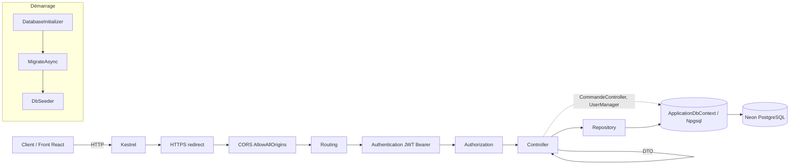

# Analyse critique du backend — GestionRestaurant

Périmètre : `backend/.NET/resto` (le dossier a été déplacé depuis `backend/NET/.NET/resto` ; ce déplacement n'est pas encore commité, voir §8).
Méthode : lecture complète de tous les `.cs`, `resto.csproj`, `appsettings*.json`, `launchSettings.json`, `resto.http`, migration `InitialCreate` ; `dotnet build` (0 erreur) et `dotnet ef migrations has-pending-model-changes` (« No changes have been made to the model since the last migration » : modèle, Fluent API, migration et snapshot sont cohérents). Aucune connexion à Neon, aucun secret lu.

Les numéros de ligne correspondent à l'état actuel du code.

---

## 1. Vue d'ensemble

### 1.1 Arborescence commentée

```
backend/.NET/
├─ resto.sln                      Solution Visual Studio (1 projet)
└─ resto/
   ├─ Program.cs                  Composition root : Swagger, DbContext Npgsql, Identity, JWT, DI, CORS, pipeline
   ├─ resto.csproj                net8.0, packages NuGet, UserSecretsId
   ├─ resto.http                  Fichier de test VS : appelle encore /weatherforecast (supprimé) → obsolète
   ├─ appsettings.json            Logging + Jwt:Issuer / Jwt:Audience (non secrets)
   ├─ appsettings.Development.json  Logging seulement
   ├─ Properties/launchSettings.json  Profils http (5118) et IIS Express
   ├─ Controllers/
   │  ├─ AccountController.cs     register, login (émet le JWT), logout
   │  ├─ ArticlesController.cs    CRUD articles
   │  ├─ CategorieController.cs   CRUD catégories + articles d'une catégorie
   │  ├─ PanierController.cs      lecture/ajout/retrait/vidage du panier
   │  ├─ CommandeController.cs    validation d'une commande, listes de commandes
   │  └─ UserController.cs        lecture/modification/suppression d'utilisateurs
   ├─ Data/
   │  ├─ ApplicationDbContext.cs  DbSets + Fluent API complète
   │  ├─ DbSeeder.cs              rôles, admin, menu tunisien
   │  └─ DatabaseInitializer.cs   IHostedService : MigrateAsync + seed au démarrage
   ├─ DTOs/                       ArticleDTO, CategorieDTO, CommandeDTO(+Item), PanierDTO(+Item), UserLogin/Register/UpdateDTO
   ├─ Models/                     ApplicationUser, Categorie, Article, Panier, PanierItem, Commande, CommandeItem, enums StatutCommande / TypeCommande
   ├─ Repositories/               I*Repository + implémentations (Article, Categorie, Panier, Commande)
   └─ Migrations/                 InitialCreate (+ Designer) et snapshot
```

### 1.2 Packages et version

| Package | Version | Remarque |
|---|---|---|
| Target framework | net8.0 | LTS dont la fin de support est annoncée pour novembre 2026 (à confirmer sur la page de support Microsoft) → viser .NET 10 LTS |
| Microsoft.AspNetCore.Authentication.JwtBearer | 8.0.10 | OK ; 1 patch derrière les autres |
| Microsoft.AspNetCore.Identity.EntityFrameworkCore | 8.0.11 | OK |
| **Microsoft.AspNetCore.Identity.UI** | 8.0.11 | **Inutile** : aucune UI Identity (pages Razor) n'est utilisée, c'est une API |
| Microsoft.EntityFrameworkCore.Tools | 8.0.11 | OK (PrivateAssets) |
| Npgsql.EntityFrameworkCore.PostgreSQL | 8.0.11 | OK |
| Swashbuckle.AspNetCore | 6.4.0 | Ancien (2022), à monter en 6.x récent ; aucune annotation XML/Swagger utilisée |
| **System.IdentityModel.Tokens.Jwt** | 8.3.0 | Redondant avec ce que JwtBearer apporte, mais utilisé directement dans AccountController pour émettre le token. À conserver tant que l'émission est dans le contrôleur |

Absents et recommandés : FluentValidation (ou DataAnnotations), Serilog, AspNetCoreRateLimit/`RateLimiter` natif, projet de tests.

### 1.3 Architecture et flux d'une requête

Architecture « contrôleurs → repositories → DbContext », sans couche service. Les repositories ne font que de l'accès aux données ; une partie de la logique métier est dans les contrôleurs (surtout `CommandeController`), qui injectent aussi directement le `ApplicationDbContext` (`CommandeController.cs:16-21`). Il n'y a ni service, ni mapper, ni validation, ni middleware d'erreur.



Point clé : le middleware `UseAuthorization` est en place mais **aucun contrôleur n'a `[Authorize]`** : l'authentification JWT est configurée, jamais exigée.

---

## 2. Modèles et base de données

### 2.1 Entités et contraintes (vérifiées dans la migration `InitialCreate.cs`)

| Table | Colonnes notables | Contraintes / index | Suppression |
|---|---|---|---|
| AspNetUsers (ApplicationUser) | Nom varchar(100) ?, DateCreation timestamptz | `EmailUniqueIndex` unique filtré (`NormalizedEmail IS NOT NULL`), `UserNameIndex` unique | — |
| Categories | Nom varchar(100) NOT NULL, Ordre, EstActive (défaut true) | `IX_Categories_Nom` unique | — |
| Articles | Nom(150), Description(1000)?, Prix numeric(10,2), ImageUrl(500)?, EstDisponible (défaut true), Ordre, CategorieId | CHECK `Prix >= 0` ; index CategorieId | FK Categories : **Restrict** |
| Paniers | UserId varchar(450), DateCreation, DateMiseAJour | **unique (UserId)** | FK AspNetUsers : Cascade |
| PanierItems | PanierId, ArticleId, Quantite | CHECK `Quantite > 0` ; unique (PanierId, ArticleId) | FK Paniers : Cascade ; FK Articles : Cascade |
| Commandes | UserId text ?, NomClient(256), Statut varchar(20) défaut `EnAttente`, TypeCommande varchar(20), Total numeric(10,2), DateCommande timestamptz, Note(500)? | CHECK `Total >= 0` ; index (UserId, DateCommande), index (Statut) | FK AspNetUsers : **SetNull** |
| CommandeItems | CommandeId, ArticleId ?, NomArticle(150), PrixUnitaire, Quantite | CHECK `Quantite > 0` ; index CommandeId, ArticleId | FK Commandes : Cascade ; FK Articles : **SetNull** |

### 2.2 Cohérence modèles / Fluent API / migration

- **Cohérente** : `has-pending-model-changes` ne détecte rien ; le SQL généré correspond à la spécification (types, FK, ON DELETE, CHECK, index).
- Détails à noter :
  - Un seul index sur `NormalizedEmail` (`EmailUniqueIndex`) : il remplace l'`EmailIndex` standard d'Identity (EF fusionne les deux), donc pas de doublon d'index.
  - `Paniers.UserId` est `varchar(450)` alors que `AspNetUsers.Id` est `text` : FK valide dans PostgreSQL, mais type différent de `Commandes.UserId` (`text`). Sans conséquence fonctionnelle, incohérence de style.
  - Les valeurs par défaut de dates (`DateCreation`, `DateCommande`) sont posées côté C# (`DateTime.UtcNow`), pas côté base (`DEFAULT now()`) : une insertion SQL manuelle échoue ou donne 0001-01-01.
  - `Statut` et `TypeCommande` stockés en texte : lisible, mais rien n'interdit en base une valeur hors enum (pas de CHECK `IN (...)`).
  - **À tester (non vérifié)** : `EstActive` / `EstDisponible` ont `HasDefaultValue(true)` *et* un initialiseur C# à `true` (`ApplicationDbContext.cs:39,50`). Avec un `bool`, EF peut ignorer une valeur `false` explicite à l'insertion si le sentinel est mal déduit ; il faut créer une catégorie avec `EstActive=false` et relire la valeur pour s'en assurer.
  - Le `Total` d'une commande n'est contraint à rien par rapport à la somme des lignes (cohérence uniquement applicative).

### 2.3 Manques pour une V1 de restaurant

- **Livraison** : `TypeCommande.Livraison` existe mais aucune adresse, téléphone ni frais de livraison. **Sur place** : pas de numéro de table. Aucun champ ne permet de saisir `TypeCommande` ni `Note` via l'API.
- Numéro de commande lisible (ex. `CMD-0042`), `DateMiseAJour`/historique des statuts, qui a changé le statut.
- Paiement (mode, statut), TVA / HT-TTC.
- Disponibilité : `EstDisponible` existe mais n'est lu nulle part ; pas de stock, d'options/suppléments, d'allergènes.
- Jeton de concurrence (`xmin` Npgsql) sur `Commande`/`Article`/`Panier`.
- Pas de suppression logique des articles (utile pour garder un historique de menu).
- Pas de table de refresh tokens, pas d'audit (`CreatedAt/By`) hors panier.
- Contraintes manquantes : `CK` sur Statut/TypeCommande, `Ordre >= 0`.

---

## 3. API

Légende : « Non » = aucun `[Authorize]`. **Aucun endpoint n'est protégé.** Tous renvoient aussi 500 en cas d'exception non gérée (non repris ci-dessous).

| Méthode | Route | Entrée | Sortie | Codes renvoyés | Protégé | Rôle |
|---|---|---|---|---|---|---|
| POST | /api/Account/register | UserRegisterDTO | `{userId, username, email, panierId}` | 200, 400 | Non | — |
| POST | /api/Account/login | UserLoginDTO | `{userId, username, email, panierId, token}` | 200, 400 (utilisateur inconnu **ou** clé JWT absente), 401 (mauvais mot de passe) | Non | — |
| POST | /api/Account/logout | — | `"success"` (texte) | 200 | Non | — |
| GET | /api/Articles | — | ArticleDTO[] | 200 | Non | — |
| GET | /api/Articles/{id} | — | ArticleDTO | 200, 404 | Non | — |
| POST | /api/Articles | ArticleDTO | ArticleDTO | 201, 500 si catégorie inexistante / prix < 0 / nom trop long | **Non** | devrait être Admin |
| PUT | /api/Articles/{id} | ArticleDTO | — | 204, 404, 500 (idem) | **Non** | devrait être Admin |
| DELETE | /api/Articles/{id} | — | — | 204, 404 | **Non** | devrait être Admin |
| GET | /api/Categorie | — | CategorieDto[] | 200 | Non | — |
| POST | /api/Categorie | CategorieDto | CategorieDto | 201, 400 (doublon exact) | **Non** | devrait être Admin |
| GET | /api/Categorie/{id} | — | CategorieDto | 200, **400** si absente | Non | — |
| GET | /api/Categorie/{id}/with-foods | — | `{Categorie, Foods[]}` | 200, 404 | Non | — |
| PUT | /api/Categorie | CategorieDto (id dans le corps) | CategorieDto | 200 (même si l'id n'existe pas), 400 | **Non** | devrait être Admin |
| DELETE | /api/Categorie/{id} | — | — | 204, 409 (catégorie non vide) | **Non** | devrait être Admin |
| GET | /api/Panier/me?userId= | query `userId` | PanierDTO | 200, 500 | **Non** | Client (son propre panier) |
| POST | /api/Panier/{panierId}/articles/{articleId} | body : entier brut | — | 204, 400 (qté ≤ 0), 500 (panier/article introuvable) | **Non** | Client |
| DELETE | /api/Panier/{panierId}/articles/{articleId} | — | — | 204, 500 | **Non** | Client |
| DELETE | /api/Panier/{panierId} | — | — | 204, 500 | **Non** | Client |
| POST | /api/Commande/validerCommandeParUser | body : `userId` (string JSON) | `{Message, CommandeId}` | 200, 400, 404, 500 | **Non** | Client |
| GET | /api/Commande/userCommandes?userId= | query | CommandeDto[] | 200, 400, **404 si aucune commande**, 500 | **Non** | Client |
| GET | /api/Commande/allCommandes | — | CommandeDto[] | 200, 404 si vide, 500 | **Non** | devrait être Admin |
| GET | /api/User/getUserInfoByName?username= | query | `{Username, Email}` | 200, 404 | **Non** | — |
| GET | /api/User/getUsers | — | **entités ApplicationUser** | 200 | **Non** | devrait être Admin |
| PUT | /api/User/updateUserInfoByName?username= | UserUpdateDTO | texte | 200, 400, 404 | **Non** | — |
| DELETE | /api/User/deleteUserByUserName?username= | — | texte | 200, 400, 404 | **Non** | — |

### Respect des conventions REST

- **Verbes dans les URL** : `validerCommandeParUser`, `getUserInfoByName`, `updateUserInfoByName`, `deleteUserByUserName`, `userCommandes`, `allCommandes`. Cible : `POST /api/commandes`, `GET /api/commandes/mine`, `GET /api/commandes` (Admin), `GET /api/users/{id}`.
- **Pluriel incohérent** : `Articles` (pluriel), `Categorie`, `Commande`, `Panier`, `User`, `Account` (singulier). Le casing `[controller]` produit des routes en PascalCase.
- **Codes de statut** : `GET /Categorie/{id}` renvoie 400 au lieu de 404 (`CategorieController.cs:48-58`) ; `userCommandes`/`allCommandes` renvoient 404 pour une liste vide (`CommandeController.cs:109,131`) au lieu de `200 []` ; `PUT /Categorie` renvoie 200 pour une catégorie inexistante ; `Panier` renvoie 500 pour « panier/article introuvable » (exception générique levée dans `PanierRepository.cs:56,61,80,93`) au lieu de 404 ; `login` renvoie 400 puis 401 selon que l'utilisateur existe ou non.
- **Pas de ProblemDetails** : les erreurs sont des chaînes brutes, des `ModelState` ou `"Internal server error: " + ex.Message`. Aucun `UseExceptionHandler`/`AddProblemDetails`.
- Identifiant dans le corps pour `PUT /Categorie` (au lieu de `/{id}`) ; `userId` passé par le client alors qu'il devrait venir du token ; corps JSON « nu » (`int`, `string`) difficile à étendre.
- Pas de pagination, de filtre, de tri, ni de versionnage.

---

## 4. Sécurité

### 4.1 Authentification et autorisation
- **Aucune autorisation.** `AddAuthentication().AddJwtBearer` est configuré (`Program.cs:60-77`) mais aucun `[Authorize]`, aucune policy, aucun `FallbackPolicy`. Le token émis ne sert à rien côté API.
- **Rôles inutilisables** : `Admin` et `Client` sont créés et attribués (`DbSeeder.cs:83`, `AccountController.cs:42`), mais le JWT ne contient pas de claim de rôle (`AccountController.cs:81-84` : Name, NameIdentifier, PanierId, Jti). `[Authorize(Roles="Admin")]` refuserait tout le monde.
- Conséquences immédiates, sans aucun compte : lister tous les utilisateurs avec leurs entités complètes (`UserController.cs:45-50`, expose `PasswordHash`, `SecurityStamp`, `ConcurrencyStamp`, `NormalizedEmail`…), supprimer n'importe quel utilisateur (`:76-92`), modifier son nom d'utilisateur/e-mail (`:52-73`), lire toutes les commandes (`CommandeController.cs:120`), créer/modifier/supprimer le menu.

### 4.2 JWT
- Durée 1 h (`AccountController.cs:101`), **pas de refresh token** : le front doit se reconnecter chaque heure.
- Signature HS256 avec clé symétrique `Jwt:SecretKey` ; la **longueur de la clé réelle n'a pas pu être vérifiée** (elle est dans les user-secrets). Il faut ≥ 32 octets aléatoires.
- Validation : issuer, audience, lifetime et signature validés (`Program.cs:69-75`). `ClockSkew` laissé à 5 min par défaut. L'émission lit `Jwt:Issuer`/`Jwt:Audience`, la validation les mêmes clés : cohérent.
- Le claim `PanierId` est mis dans le token (`:83`) : redondant (le panier se retrouve par l'utilisateur) et périmé si le panier change.
- `logout` appelle `SignOutAsync` (`:131`) qui n'a **aucun effet** sur un JWT ; pas de révocation, pas de liste de jetons invalidés.
- Le token n'est pas renvoyé par `register` ; le front doit enchaîner avec `login`.

### 4.3 Mots de passe, comptes
- Politique : défauts d'Identity (6 caractères, majuscule, minuscule, chiffre, caractère spécial). Acceptable en V1, 8-10 serait préférable.
- **Verrouillage inactif** : `CheckPasswordAsync` (`:75`) ne compte pas les échecs ; `SignInManager.CheckPasswordSignInAsync(..., lockoutOnFailure: true)` serait nécessaire → force brute possible, sans rate limiting.
- **Énumération d'utilisateurs** : utilisateur inconnu → 400 (corps vide), mauvais mot de passe → 401 ; `register` renvoie les codes Identity (`DuplicateUserName`, `DuplicateEmail`, `AccountController.cs:56-59`).
- `register` : `AddToRoleAsync` (`:42`) et la création du panier ne sont ni vérifiés ni transactionnels ; un échec laisse un compte sans rôle.
- Pas de confirmation d'e-mail, pas de « mot de passe oublié », pas de changement de mot de passe.

### 4.4 CORS, HTTPS
- **CORS `AllowAnyOrigin/Method/Header`** (`Program.cs:88-97`) en toutes circonstances. À restreindre à l'origine du front, par environnement.
- `UseHttpsRedirection` actif mais le profil `http` n'expose que `http://localhost:5118` → en dev la redirection n'a pas de port HTTPS (avertissement) ; pas de `UseHsts` en production.
- `UseDeveloperExceptionPage` (`:108`) limité à Development : correct, mais redondant (déjà par défaut en dev).

### 4.5 Exposition de données, IDOR, injection, validation
- **Fuite de données** : `GetUsers` renvoie les entités (`:49`) ; tout le reste utilise des DTO (bien).
- **IDOR généralisé** : l'identité vient toujours du client — `userId` en body (`CommandeController.cs:40`), en query (`:96`, `PanierController.cs:19`), `panierId` en route (`PanierController.cs:45,62,76`), `username` en query (`UserController`). N'importe qui peut lire/modifier le panier ou valider/lister les commandes de n'importe qui.
- **Injection SQL** : aucune concaténation SQL, tout passe par LINQ/EF (paramétré). Risque faible.
- **Validation des entrées** : aucune annotation sur les DTO. `[ApiController]` valide donc… rien. Un nom vide, un prix négatif, un `CategorieId` inexistant, un nom > 150 caractères arrivent jusqu'à PostgreSQL et déclenchent un **500** (violation de CHECK/FK/longueur). Quantité panier sans plafond (`PanierRepository.cs` : `+=` sans borne ; dépassement d'entier → 500).
- **Messages d'erreur bavards** : `"…: " + ex.Message` dans 8 `catch` (`CommandeController.cs:87,91,116,138`, `PanierController.cs:41,58,72,86`) ; `CommandeController.cs:87` renvoie même `InnerException.Message` (noms de contraintes/tables PostgreSQL).
- **Limitation de débit** : absente (login, register, panier).
- **Secrets** : chaîne de connexion, clé JWT et mot de passe admin sont dans les user-secrets (clés `ConnectionStrings:Default`, `Jwt:SecretKey`, `Seed:AdminPassword`), plus dans le dépôt Git (vérifié par `git grep`). Reste à décider d'un coffre pour l'hébergement (variables d'environnement). Le **mot de passe admin est semé en prod** depuis la même clé : prévoir de le changer après le premier démarrage.
- Swagger exposé seulement en Development (bien) ; le schéma de sécurité est de type `ApiKey`, pas `Http/bearer`.

---

## 5. Logique métier

### Panier
- Un panier unique par utilisateur, créé par `GetOrCreatePanierAsync` (`PanierRepository.cs:18-39`) ; la course entre deux créations simultanées est gérée via l'index unique et un re-fetch. Défaut : le `catch (DbUpdateException)` est trop large — pour un `userId` inexistant (`GET /Panier/me?userId=xxx`), la violation de FK est avalée puis re-levée → 500 au lieu de 404.
- Prix = prix courant de l'article (`Include(Article)`), cohérent avec le choix voulu ; mais **un article indisponible (`EstDisponible=false`) peut être ajouté** : le champ n'est jamais testé.
- Ajout (`:50-77`) : lecture puis insertion sans verrou ; deux ajouts concurrents du même article violent l'index unique (`PanierId, ArticleId`) → 500. Pas de plafond de quantité.
- Pas d'endpoint pour *modifier* une quantité (seulement ajouter en cumulant, ou supprimer la ligne).
- Erreurs « introuvable » levées via `new Exception(...)` (`:56,61,80,93`) → mappées en 500.

### Commande (`CommandeController.cs:39-93`)
- **Prix recalculés côté serveur** depuis `Article.Prix` : bon (le client ne peut pas imposer un prix). Nom d'article et prix copiés en historique : bon.
- **Panier non vidé** après commande (reporté volontairement) : un double clic, ou un rejeu, crée des commandes en double. Pas d'idempotence.
- **Pas de transaction** autour de « créer commande + vider panier » (inexistante pour l'instant, à ajouter avec le vidage).
- Aucun contrôle de disponibilité ni d'existence résiduelle des articles. Les replis `?? "Nom d'article inconnu"` / `?? 0` (`:67,69`) sont du code mort (la FK garantit l'article) — mais s'ils s'exécutaient, ils créeraient une ligne à 0 € silencieusement.
- `TypeCommande` toujours `SurPlace` (valeur 0 par défaut), `Note` jamais saisissable : l'entrée est juste un `userId`.
- **Statuts** : l'enum existe (`EnAttente → EnPreparation → Prete → Terminee / Annulee`) mais aucun endpoint ne le modifie et aucune règle de transition n'existe. Le front/Admin ne peut pas traiter une commande.
- Concurrence : pas de jeton de version sur `Commande` ; deux changements de statut simultanés s'écraseraient.
- Fuseau : tout en UTC, bon ; les DTO renvoient un `DateTime` UTC (sérialisé avec `Z`).

---

## 6. Qualité du code

- **Logique dans les contrôleurs** : `ValiderCommandeParUser` (≈55 lignes) construit l'agrégat et calcule le total ; `CommandeController` utilise à la fois `ICommandeRepository` et `ApplicationDbContext` (accès mixte, `:16-21,50-58,124-127`). → un `CommandeService`.
- **Duplication** : mapping entité→DTO répété (`ToDto` dans `ArticlesController` et `CommandeController`, mapping manuel dans `CategorieController`, `PanierController`) ; 8 blocs `try/catch (Exception)` quasi identiques → un middleware d'erreurs.
- **Repositories fins** : `ArticleRepository`/`CategorieRepository` sont des wrappers CRUD de `DbSet` ; avec EF Core, un repository générique n'apporte pas grand-chose, sauf pour les requêtes complexes (panier, commande). `ICommandeRepository.GetCommandesByClientIdAsync` lève `ArgumentException` (500) sur entrée vide.
- **Nommage** : mélange FR/EN (`Quantity` côté DTO, `Quantite` côté modèle — compromis de compatibilité front), `GetByID` vs `GetById`, `ArticleDTO` vs `CategorieDto`, variable `ArticleDto` en PascalCase (`CategorieController.cs:77`), `_token` (`AccountController`), `Ajouter`/`Edit`/`Delete` mélangés. Contrôleur `Articles` pluriel vs `Categorie` singulier.
- **async/await** : correct (plus de `.Result`/`async` sans `await` ; build à 0 warning).
- **Nullabilité** : activée et propre (0 warning) ; `Article.Categorie?` mais `Categorie.Articles` non nullable initialisé : correct. `ImageUrl = string.Empty` dans le seed (`DbSeeder.cs:113`) alors que la colonne est nullable : valeur vide ≠ null, à unifier.
- **Gestion des exceptions** : `catch (Exception)` partout, exceptions génériques `new Exception(...)`, aucune exception métier typée.
- **DI** : lifetimes corrects (scoped). `UserController` injecte `SignInManager` et `IConfiguration` sans les utiliser (`:17`). `AccountController` : `IConfiguration` utilisé pour fabriquer le JWT dans le contrôleur → un `ITokenService`.
- **Magic strings** : noms de rôles centralisés en constantes (bien) ; clés de configuration (`"Jwt:SecretKey"`…) dupliquées entre `Program.cs` et `AccountController` → `JwtOptions` (Options pattern).
- **Code mort / résiduel** : `resto.http` appelle `/weatherforecast` supprimé ; `IPanierRepository.GetPanierByIdAsync` public seulement pour usage interne ; `UseRouting` explicite inutile en minimal hosting ; commentaires erronés (`// GET: api/Account/GetUser` dans `UserController.cs:22,44`) ; commentaires évidents (« Database Configuration », « Controllers »).
- **Bug de logique** : `UserController.cs:63` affecte `Nom` à **UserName** (et ignore la propriété `Nom` d'`ApplicationUser`) — changer le nom d'utilisateur casse le login de l'utilisateur sans qu'il le sache.
- **Seed non idempotent au sens métier** (`DbSeeder.cs:90-118`) : il recrée à chaque démarrage tout article/catégorie *absent par son nom*. Un article du seed renommé ou supprimé par l'admin **réapparaît** au redémarrage ; une catégorie renommée est dupliquée.

---

## 7. Performance

- **N+1** : aucun détecté ; les listes utilisent `Include`. Dans `ValiderCommande`, `Include(Items).ThenInclude(Article)` charge tout en une requête (bien).
- **Include inutile** : `GetAllArticlesAsync` et `GetArticleByIdAsync` chargent `Categorie` alors que `ArticleDTO` ne l'expose pas (`ArticleRepository.cs:18,23`).
- **AsNoTracking absent** sur toutes les lectures seules (articles, catégories, commandes, `GetUsers`).
- **Pas de pagination** : `GET /Articles`, `allCommandes`, `getUsers` renvoient tout. `allCommandes` charge toutes les commandes avec lignes, sans tri (`CommandeController.cs:124-127`) → à paginer et trier par `DateCommande` desc.
- `UpdateArticleAsync` : `DbSet.Update` sur une entité déjà suivie (avec `Categorie` incluse) marque aussi la catégorie comme modifiée → UPDATE superflu possible (comportement à confirmer à l'exécution).
- **Index** : bien couverts pour l'existant (Statut, UserId+DateCommande, uniques). Manquants éventuels : `Articles(CategorieId, Ordre)` pour l'affichage du menu, `Commandes(DateCommande)` pour le tableau de bord admin.
- **Auto-migration au démarrage** (`DatabaseInitializer.cs`) : pratique en dev, risqué ailleurs — pas de verrou entre instances multiples avec EF 8, un échec de migration empêche l'API de démarrer, migrations exécutées avec les droits applicatifs, et sur Neon le démarrage dépend du réveil de la base (le retry d'EF aide). Le **seed** fait ≈ 2 requêtes par catégorie à *chaque* démarrage (≈ 20 requêtes) : négligeable en dev, coûteux sur une base serverless qui se réveille. La connexion via l'hôte `-pooler` (pgbouncer) peut poser problème pour les migrations : **non vérifié**.
- `EnableRetryOnFailure` est configuré (bien pour Neon) ; en contrepartie, toute transaction manuelle future devra passer par `CreateExecutionStrategy()`.

---

## 8. Configuration et déploiement

- `appsettings.json` : logging, `AllowedHosts: *`, `Jwt:Issuer`, `Jwt:Audience` (non secrets). `appsettings.Development.json` : logging seul. Pas de `appsettings.Production.json`.
- **Clés de configuration requises** (valeurs non lues) : `ConnectionStrings:Default`, `Jwt:SecretKey`, `Seed:AdminPassword`. Le démarrage échoue explicitement si les deux premières manquent (`Program.cs:43-44,57-58`) — bien. En hébergement : variables d'environnement `ConnectionStrings__Default`, `Jwt__SecretKey`, `Seed__AdminPassword`.
- **Profils de lancement** : `http` (5118, Swagger) et `IIS Express` (15376, `sslPort: 0`) ; pas de profil https ; `launchBrowser: true`.
- **Même base partout** : le code pointe sur la branche Neon « main/production » — pas de séparation dev/prod ; une migration ou un test destructeur touche la production. Recommandé : branche Neon `dev` (gratuite, copie instantanée).
- **Hébergement** : pas de Dockerfile, pas de health check (`AddHealthChecks().AddNpgSql/AddDbContextCheck`), pas de logs structurés, CORS non paramétré par environnement, `AllowedHosts: *`, pas de `UseForwardedHeaders` si derrière un proxy.
- **Dépôt Git** : le déplacement `backend/NET/.NET → backend/.NET` et `frontend/front_resto → frontend` n'est pas commité : `git status` montre 77 suppressions et les nouveaux chemins non suivis. À commiter pour ne pas perdre la correspondance avec l'historique.

---

## 9. Tests et documentation

- **Aucun test** (ni unitaire, ni d'intégration) : pas de projet de tests dans la solution.
- **Swagger** : actif en Development seulement ; aucune description (`<summary>`, `[ProducesResponseType]`), schéma de sécurité de type `ApiKey` (le `Bearer ` doit être saisi à la main) au lieu de `Http`/`bearer`.
- **README backend** : inexistant (pas de procédure d'installation, de clés de configuration, de migration, de seed).
- `resto.http` obsolète.

---

## 10. Liste des problèmes

| N° | Gravité | Fichier:ligne | Description | Impact concret | Correction proposée |
|---|---|---|---|---|---|
| 1 | Critique | Tous les contrôleurs (ex. `UserController.cs:10`) | Aucun `[Authorize]` ni policy | Toute l'API est publique : créer/supprimer des articles, supprimer des utilisateurs | `FallbackPolicy` exigeant l'authentification + `[AllowAnonymous]` explicite sur lectures du menu/login/register ; `[Authorize(Roles="Admin")]` sur l'écriture |
| 2 | Critique | `UserController.cs:45-50` | `getUsers` renvoie les entités `ApplicationUser` | Fuite de `PasswordHash`, `SecurityStamp`, e-mails de tous les clients, sans compte | DTO minimal + Admin only |
| 3 | Critique | `UserController.cs:76-92`, `52-73` | Suppression/modification d'un utilisateur par `username` en query, anonyme | N'importe qui supprime le compte admin ou change un e-mail | Admin only ou « moi-même » via claim ; supprimer ces routes en V1 |
| 4 | Critique | `CommandeController.cs:40,96,120` ; `PanierController.cs:19,45,62,76` | Identité fournie par le client (`userId`, `panierId`) = IDOR | Lire/modifier le panier et les commandes d'autrui, lire toutes les commandes | Récupérer l'utilisateur depuis `ClaimTypes.NameIdentifier` ; routes `/me` |
| 5 | Critique | `AccountController.cs:81-84` | Pas de claim de rôle dans le JWT | Les rôles Admin/Client ne peuvent pas être appliqués | `AddClaims(roles)` à l'émission (ou `GetRolesAsync`) |
| 6 | Important | `AccountController.cs:75` | Pas de verrouillage de compte ni de rate limiting | Force brute sur le login | `CheckPasswordSignInAsync(lockoutOnFailure:true)` + `AddRateLimiter` |
| 7 | Important | `Program.cs:88-97` | CORS ouvert à toutes origines | Tout site peut appeler l'API au nom d'un navigateur | Origines explicites depuis la configuration |
| 8 | Important | `CommandeController.cs:81-83` | Panier non vidé, pas de transaction ni d'idempotence | Doubles commandes au double clic | Vider le panier dans la même transaction (étape suivante) |
| 9 | Important | Contrôleurs (8 `catch`) | `ex.Message`/`InnerException.Message` renvoyés au client | Fuite de détails internes (tables, contraintes) | `UseExceptionHandler` + `ProblemDetails`, logs côté serveur |
| 10 | Important | DTOs (`ArticleDTO.cs`, `UserRegisterDTO.cs`…) | Aucune validation | Prix négatif, catégorie inexistante, nom vide → 500 PostgreSQL | DataAnnotations ou FluentValidation + vérification de la catégorie |
| 11 | Important | `PanierRepository.cs:56,61,80,93` | `throw new Exception` pour « introuvable » | 500 au lieu de 404 | Exceptions métier ou `Result` mappés en 404/409 |
| 12 | Important | `PanierRepository.cs:50-77` | Ajout non atomique, pas de plafond de quantité | 500 sur ajouts concurrents ; dépassement d'entier | Upsert/ retry sur violation d'unicité ; max (ex. 20) |
| 13 | Important | `DbSeeder.cs:90-118` | Seed recrée les éléments supprimés/renommés | L'admin ne peut pas durablement supprimer un plat du seed | Ne seeder que si les tables sont vides, ou flag « seed appliqué » |
| 14 | Important | `UserController.cs:63` | `UserName = model.Nom` | Casse le login de l'utilisateur ; propriété `Nom` ignorée | Mettre à jour `Nom`, ne pas toucher `UserName` |
| 15 | Important | Pas d'endpoint de statut | Les statuts de commande ne sont pas modifiables ; pas de `TypeCommande`/`Note` en entrée | Le workflow cuisine est impossible | `PATCH /commandes/{id}/statut` avec règles de transition |
| 16 | Important | `DatabaseInitializer.cs` | Migration + seed à chaque démarrage, sur la production | Échec = API indisponible ; course entre instances | Commande dédiée/étape de déploiement ; garder en dev seulement |
| 17 | Important | Environnement | Une seule base (branche Neon production) pour dev et prod | Un test destructeur touche les vraies données | Branche Neon `dev` + secrets séparés |
| 18 | Mineur | `CategorieController.cs:48-58`, `CommandeController.cs:109,131` | 400 au lieu de 404 ; 404 sur liste vide | Contrat REST trompeur pour le front | 404 / `200 []` |
| 19 | Mineur | `AccountController.cs:128-133` | `logout` sans effet sur un JWT | Faux sentiment de déconnexion | Supprimer la route (le front supprime le token) ou implémenter refresh token révocable |
| 20 | Mineur | `AccountController.cs:83` | Claim `PanierId` | Redondant/périmé | Le retirer |
| 21 | Mineur | `ArticleRepository.cs:18,23` | `Include(Categorie)` inutile ; pas d'`AsNoTracking`, pas de pagination | Requêtes plus lourdes que nécessaire | `AsNoTracking`, projections `Select`, pagination |
| 22 | Mineur | `ApplicationDbContext.cs:39,50` | `HasDefaultValue(true)` sur booléens | Risque d'ignorer `false` à l'insertion (à tester) | Test d'intégration ; retirer le défaut base si nécessaire |
| 23 | Mineur | `resto.csproj:13` | `Identity.UI` inutile ; Swashbuckle 6.4.0 ancien | Dépendances superflues | Retirer / mettre à jour |
| 24 | Mineur | `resto.http` | Appelle un endpoint supprimé | Fichier de test trompeur | Le réécrire ou le supprimer |
| 25 | Mineur | `UserController.cs:17`, `Program.cs` | Paramètres injectés inutilisés ; commentaires erronés/évidents | Bruit | Nettoyer |
| 26 | Mineur | `Program.cs:14-40` | Schéma Swagger `ApiKey` | Saisie manuelle de `Bearer ` | `SecuritySchemeType.Http`, `Scheme = "bearer"` |
| 27 | Mineur | `resto.csproj:4` | .NET 8 proche de sa fin de support | Plus de correctifs de sécurité | Migrer vers .NET 10 LTS |
| 28 | Mineur | Projet | Aucun test, README, Dockerfile, health check, logs structurés | Non industrialisable | Voir §12 |

---

## 11. Verdict : garder ou réécrire

| Composant | Décision | Raison |
|---|---|---|
| Models (7 entités + 2 enums) | **Garder** | Propres, nullable corrects, une classe par fichier ; ajouter les champs V1 manquants |
| ApplicationDbContext (Fluent API) | **Garder** | Complet et cohérent avec la migration (vérifié) |
| Migration `InitialCreate` + snapshot | **Garder** | Cohérente ; ne pas la modifier à la main |
| DbSeeder | **Adapter** | Bon contenu, mais ne doit pas ressusciter les données supprimées ; mot de passe admin à changer |
| DatabaseInitializer | **Adapter** | OK en dev ; sortir la migration du démarrage en production |
| Program.cs | **Adapter** | Bonne base (fail-fast sur la config, retry Npgsql) ; ajouter auth requise, CORS, ProblemDetails, rate limiting, health checks, Options |
| AccountController | **Réécrire** | Logique JWT dans le contrôleur, pas de rôles, pas de lockout, énumération ; extraire un `AuthService`/`TokenService` |
| UserController | **Réécrire** | Anonyme, fuite d'entités, bug `UserName` ; ne garder que `GET /users/me` et une administration réduite |
| CommandeController | **Réécrire** | IDOR, logique métier dedans, pas de transaction ; passer par un `CommandeService` |
| PanierController + PanierRepository | **Adapter** | Bonne idée (`GetOrCreate`, prix courant) ; passer en `/panier` basé sur le token, erreurs typées |
| ArticlesController / CategorieController | **Adapter** | CRUD correct mais non protégé, sans validation, codes de statut à corriger |
| ArticleRepository / CategorieRepository / CommandeRepository | **Adapter** | Fins mais corrects ; ajouter `AsNoTracking`, pagination |
| DTOs | **Adapter** | À valider, à séparer entrée/sortie (CreateArticleRequest vs ArticleResponse) |
| resto.csproj | **Adapter** | Retirer `Identity.UI`, aligner les versions |
| resto.http | **Réécrire** | Obsolète |

### Notes sur 10 (état actuel)

| Critère | Note | Justification |
|---|---|---|
| Sécurité | **2/10** | JWT et rôles bien posés en base, mais rien n'est appliqué : API entièrement publique, IDOR, fuite de hachages, CORS ouvert |
| Architecture | **5/10** | Séparation contrôleurs/repositories/DbContext saine, Options/DI propres ; pas de couche service, logique dans les contrôleurs, pas de gestion d'erreur globale |
| Qualité du code | **6/10** | Compile sans warning, nullabilité propre, async correct ; duplication, `catch (Exception)`, quelques bugs et incohérences de nommage |
| Prêt pour la production | **2/10** | Sécurité insuffisante, pas de tests, pas de CI/Docker/health check, une seule base, migration au démarrage |

Global : **le socle de données est bon à garder ; la couche API (sécurité, commande, utilisateurs) est à reprendre.** Pas besoin de tout réécrire.

---

## 12. Comment commencer

### 12.1 Architecture cible (mono-restaurant)

Chaque choix est suivi d'une alternative plus simple.

- **Organisation** : un seul projet Web API structuré en dossiers par fonctionnalité (`Features/Menu`, `Features/Panier`, `Features/Commandes`, `Features/Auth`, `Common/`, `Data/`) + un projet `resto.Tests`. *Pourquoi* : pour un portfolio, la solution multi-projets « Clean Architecture » ajoute du code de liaison sans bénéfice visible. *Alternative plus simple* : garder les dossiers actuels (`Controllers/Services/Repositories/DTOs`).
- **Couches** : Contrôleur (HTTP uniquement) → Service (règles métier, transactions) → `DbContext` directement. *Pourquoi* : EF Core est déjà un repository + unit of work ; on ne garde un repository que pour le panier si vous voulez. *Alternative* : conserver les repositories actuels.
- **DTO** : `record` séparés en entrée (`...Request`) et sortie (`...Response`), mapping manuel dans des méthodes d'extension. *Pourquoi* : jamais d'entité exposée, contrat stable. *Alternative* : Mapperly (génération à la compilation) si les mappings se multiplient.
- **Validation** : FluentValidation. *Pourquoi* : règles testables et regroupées hors des DTO. *Alternative* : DataAnnotations (`[Required]`, `[Range]`, `[StringLength]`) — suffisant pour cette taille et sans dépendance.
- **Erreurs** : `AddProblemDetails()` + `IExceptionHandler` global + exceptions métier (`NotFoundException`, `ConflictException`). *Pourquoi* : réponses RFC 7807 homogènes et zéro fuite d'`ex.Message`. *Alternative* : `UseExceptionHandler` simple + `Results.Problem`.
- **Authentification** : Identity + JWT d'accès court (15-30 min) avec claims de rôle ; refresh token **optionnel**. *Pourquoi* : le front React stocke le token ; le refresh évite une reconnexion fréquente. *Alternative plus simple* : JWT 8 h sans refresh pour la V1, en connaissant la limite (pas de révocation) ; ou cookie `HttpOnly` si front et API partagent le domaine.
- **Autorisation** : `FallbackPolicy` = utilisateur authentifié, policies `AdminOnly` / `ClientOnly`, `[AllowAnonymous]` explicite sur le menu. *Pourquoi* : sûr par défaut (on ne peut plus oublier de protéger). *Alternative* : `[Authorize]` sur chaque contrôleur.
- **Pagination** : `page`/`pageSize` bornés avec réponse `{items, total, page, pageSize}` sur commandes et utilisateurs. *Alternative* : pagination par curseur (`id` décroissant) si la liste grossit ; pas nécessaire pour le menu (≈ 40 articles).
- **Logs** : Serilog (console + fichier ou Seq) avec enrichissement d'un `CorrelationId`. *Alternative* : `ILogger` natif avec `AddJsonConsole()` — suffisant pour Render/Azure/Railway.
- **Tests** : xUnit + `WebApplicationFactory` + Testcontainers PostgreSQL (ou branche Neon dédiée aux tests). *Pourquoi* : les vrais risques sont des contraintes PostgreSQL et l'autorisation, que SQLite/InMemory ne reproduisent pas. *Alternative* : tests unitaires de services + quelques tests d'intégration sur l'auth.
- **Divers** : `RateLimiter` natif sur `login`/`register`, `AddHealthChecks().AddDbContextCheck`, CORS par environnement, Options pattern (`JwtOptions`), Swagger `Http/bearer`.

### 12.2 Ordre de réalisation

| Bloc | Objectif | Fichiers concernés | Critères de réussite vérifiables |
|---|---|---|---|
| **0. Hygiène** | Commiter le déplacement de dossiers, créer une branche Neon `dev`, README minimal | Git, user-secrets, `README.md` | `git status` propre ; l'API démarre sur la branche dev ; la production n'est plus utilisée en dev |
| **1. Sécurité de base** | Fermer l'API | `Program.cs`, tous contrôleurs, `AccountController` | Sans token : 401 sur tout sauf menu/login/register ; avec token Client : 403 sur écriture menu ; token sans rôle refusé ; `getUsers` n'expose plus de hachage |
| **2. Identité depuis le token** | Supprimer les IDOR | `PanierController`, `CommandeController`, `UserController` | Un client A reçoit 403/404 en visant le panier ou les commandes de B (test d'intégration) ; plus aucun `userId` en entrée |
| **3. Erreurs et validation** | Contrat d'API propre | `Program.cs`, DTOs, validateurs, exceptions métier | Prix négatif/catégorie inconnue → 400 (jamais 500) ; erreurs au format ProblemDetails ; aucun `ex.Message` dans les réponses |
| **4. Commande complète** | Logique métier fiable | `CommandeService`, `CommandeController`, `PanierRepository` | Commande + vidage du panier dans une transaction ; double requête → 1 seule commande ; articles indisponibles refusés ; `TypeCommande` et `Note` saisissables |
| **5. Statuts de commande** | Workflow cuisine | endpoint `PATCH statut`, règles de transition, jeton de concurrence | Transition invalide → 409 ; Admin seul ; `GET commandes` paginé et trié |
| **6. Menu admin** | Gérer le menu | `ArticlesController`, `CategorieController`, DTO avec `ImageUrl`, `EstDisponible`, `Ordre` | Création/édition/désactivation (pas de suppression) ; la lecture publique ne renvoie que les éléments actifs/disponibles, triés par `Ordre` |
| **7. Seed et démarrage** | Sortir les migrations de la production | `DbSeeder`, `DatabaseInitializer` | Le seed ne recrée pas un plat supprimé ; migration lancée par une commande/étape CI en prod |
| **8. Tests et CI** | Filet de sécurité | projet `resto.Tests`, workflow GitHub Actions | `dotnet test` vert en CI ; tests : auth, IDOR, commande, contraintes DB |
| **9. Exploitation** | Prêt pour l'hébergement | Dockerfile, health checks, CORS par environnement, logs JSON, rate limiting | `GET /health` OK ; image Docker démarre avec variables d'environnement seules ; CORS refuse une origine inconnue |

### 12.3 Risques et pièges pour un projet de portfolio

- **Publier l'API avec l'état actuel** : les recruteurs qui lisent le code (ou appellent Swagger) verront l'absence d'`[Authorize]`. C'est le premier point à corriger avant toute mise en ligne.
- **Utiliser la base de production pour le développement** : créer la branche `dev` avant le bloc 1.
- **Fuite de secrets dans Git** : ne jamais commiter `appsettings.*` avec des valeurs réelles ; si une clé a déjà été publiée (c'était le cas de l'ancienne clé JWT dans l'historique si un dépôt distant existait), la renouveler.
- **Sur-ingénierie** : CQRS/MediatR, microservices, multi-projets sont hors sujet pour un seul restaurant ; mieux vaut un petit périmètre bien testé que beaucoup de couches.
- **Changer le contrat sans prévenir le front** : les noms (`Quantity`, `ArticleName`, `OrderDate`, routes `Categorie`…) sont consommés par React ; versionner (`/api/v1`) ou migrer les deux côtés dans le même changement.
- **Oublier la maintenance de la migration** : ne jamais éditer `InitialCreate` après application ; créer de nouvelles migrations. Vérifier `has-pending-model-changes` en CI.
- **Tests sur EF InMemory/SQLite** : ils masquent les contraintes PostgreSQL (CHECK, index uniques filtrés, `timestamptz`).
- **Prix en `decimal` et arrondis** : garder `numeric(10,2)` partout, arrondir explicitement (`Math.Round(..., 2)`) si des remises/TVA arrivent.
- **Dates** : conserver strictement l'UTC (Npgsql rejette `Kind=Unspecified`) ; convertir à l'affichage.
- **Dette de documentation** : un README avec la liste des clés de configuration (noms uniquement), la procédure de migration et un schéma de la base vaut plus qu'une fonctionnalité de plus.

---

## Ce qui n'a pas pu être vérifié

- Le comportement à l'exécution (aucun `dotnet run`, aucune requête, conformément à la consigne) : codes HTTP réels, comportement de `EstActive=false` à l'insertion, UPDATE superflu de `Categorie`, réponses de l'API.
- L'état de la base Neon : la migration `InitialCreate` y a-t-elle été appliquée ? Le seed a-t-il tourné ? L'hôte `-pooler` fonctionne-t-il pour les migrations ?
- La longueur/entropie de la clé `Jwt:SecretKey` et la force du mot de passe `Seed:AdminPassword` (valeurs non lues).
- La fin de support exacte de .NET 8 (à confirmer sur la page officielle de support).
- Le code du front (hors périmètre) : quelles routes et quels noms de champs il consomme réellement.
